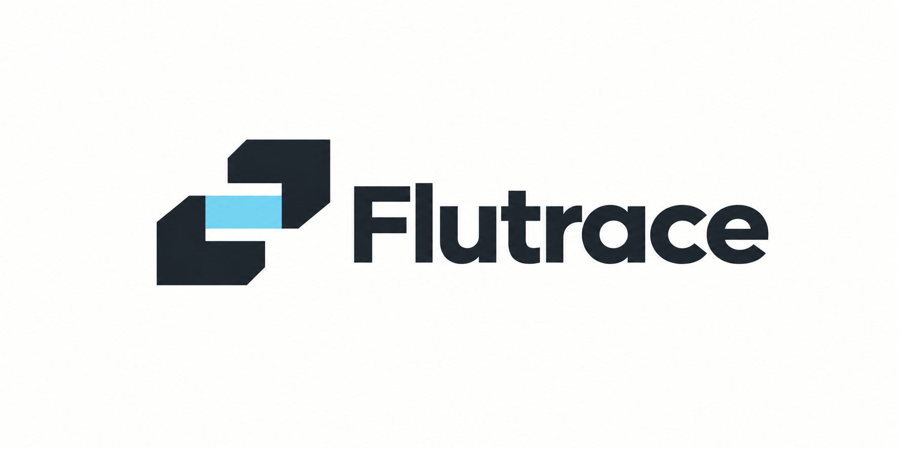
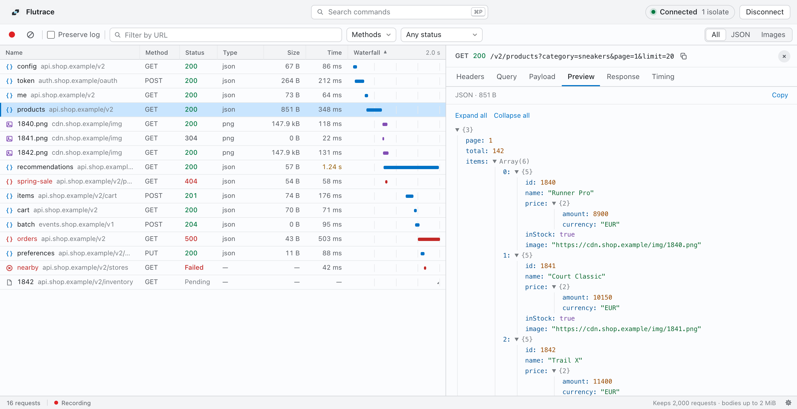

<p align="center">
  
</p>

<p align="center">Network inspector for Flutter.</p>

<picture>
  <source media="(prefers-color-scheme: dark)" srcset="assets/screenshot-dark.png">
  
</picture>

<p align="center"><sub>Demo data from <code>npm run mock-vm</code>.</sub></p>

Flutrace is a macOS app that shows the HTTP requests a Flutter app makes while
it runs in debug mode. It reads them from the Dart VM Service, so there is no
proxy to configure, no certificate to install, and nothing to add to your app.
Connect to the running app and you get a request list with a waterfall, plus
headers, bodies, JSON, images, and timing for each request.

This is an early build. Capture has been tested on a physical iPhone, and
**Find app** on the iOS Simulator and an Android emulator.

[Download the latest DMG](https://github.com/RiccardoCherchi/flutrace/releases/latest)
for macOS 12 or later (Apple Silicon and Intel). Builds are unsigned and not
notarized: open the DMG, drag Flutrace into Applications, and if macOS blocks
the first launch, go to System Settings > Privacy & Security > Open Anyway.
You can also [build it yourself](#build-on-macos).

## Inspect a session

1. Run your Flutter app in debug mode from your editor or with `flutter run`.
2. Open Flutrace. It starts looking for running apps right away; click
   **Connect** next to yours. Apps on the iOS Simulator show up within a second
   or two, and Android emulators after a few seconds. Physical devices may not
   be found. Once you have captured requests, **Find app** in the title bar
   runs the search again.
3. If your app isn't listed, paste the Dart VM Service URL from your debug console.
   Copy just the URL, without the log prefix. A DevTools link containing a VM
   `uri` works too.
4. Use your app to generate requests, then select a row in Flutrace.

Flutrace accepts local addresses (`localhost`, `127.0.0.1`, and `::1`) over
HTTP(S) or WS(S). Physical devices need the port forwarding provided by Flutter
tooling. Under **Find app > Options**, you can specify a Flutter SDK folder or
an app bundle/package ID if the automatic search needs help.

Capture starts when you connect. Requests made earlier are not imported.
Hot restart creates new isolates, which Flutrace checks for automatically.
Stopping and relaunching the app may change its URL; reconnect if that happens.

## In the inspector

- Filter by URL, HTTP method, status, or JSON/image response type. Select several
  methods at once and click column headings to sort.
- Read request and response headers, query parameters, payloads, and VM timing
  events alongside the request waterfall. Requests that took a second or longer
  are highlighted.
- Expand or collapse JSON in Preview, read highlighted response source, and
  preview captured PNG, JPEG, GIF, and WebP images. Response highlighting covers
  JSON, XML, HTML, JavaScript, and CSS.
  Large responses fall back to plain text. Expand all is capped at 1,000 entries,
  100 per branch, and 20 levels; deeper JSON remains available in Response.
- Click a JWT in a header, URL, payload, or response to decode its header and
  claims locally. This does not verify its signature or decrypt JWE tokens.
- Pause capture, clear the local log, preserve it across reconnects, or copy a
  request URL or cURL command. cURL includes captured headers and body; it is
  available once the complete request body has loaded. Copy buttons briefly
  confirm when they succeed.
- Find text in a body with ⌘F and switch between pretty and raw. ⇧⌘F searches
  the URLs, headers, and bodies of every captured request as you type; use the
  arrow keys to step through matches.
- Right-click a request to copy its URL, cURL command, or bodies, or to show only
  requests to its host.
- Open the command palette with ⌘P or from the bar at the top of the window.
  ⌘K clears the log and ⌘E pauses or resumes recording, as in Chrome DevTools.
- Pick a theme (Flutrace, Fjord, Paper, or Dusk), each with light and dark
  variants, and change keyboard shortcuts in Settings (⌘,). Appearance follows
  macOS unless you choose Light or Dark.
- Resize the details pane by dragging its edge or using the arrow keys. Its
  width is remembered.

## What it can capture

Flutrace reads the HTTP profiling data exposed by the VM. That includes
`dart:io` HttpClient, standard Dio traffic using that client, and clients that
publish compatible `http_profile` data. Native SDK traffic is not automatically
visible. Flutter web and normal release builds are unsupported.

An image served from the app's cache may never produce a network request.
A `304 Not Modified` response has no image body to preview; Flutrace does not
read the app cache or fetch the image again. The Size column shows Content-Length
when available, rather than measured transfer bytes. Timing comes from the VM;
missing values stay unknown.

The table keeps up to 2,000 requests and loads bodies when you select a row,
with a 2 MiB limit per body. These limits do not bound the VM's own profiling
history or guarantee a fixed peak memory usage.

## Captured data

Headers and bodies stay in memory. While connected, Flutrace writes the VM URL to
`~/Library/Application Support/com.riccardocherchi.flutrace/session.json`, readable
only by your user, so `flutrace-mcp` can attach; the file is removed when you
disconnect or quit. Flutrace has no analytics or
automatic capture exports. Copy URL and Copy cURL write to the clipboard only
when clicked. cURL commands include captured credentials, such as authorization
headers and cookies.
Captured HTML and SVG are displayed as text; image previews use the captured bytes.

The VM URL contains a session token. Keep it, captured credentials, and private
payloads out of issues and screenshots.

On a clean disconnect, Flutrace restores the profiling setting it found when
connecting. That setting is shared with other inspectors, and an unexpected
disconnect can prevent restoration. Traffic never passes through Flutrace, so
closing it does not interrupt your app's network requests.

## Use it from an AI agent (MCP)

`flutrace-mcp` is a local MCP server that lets coding agents read the same
traffic. It runs over stdio on your machine, connects only to localhost VM
Services, and does not need the desktop app. You need Node.js 22 or later.

```sh
claude mcp add flutrace -- npx -y flutrace-mcp    # Claude Code
codex mcp add flutrace -- npx -y flutrace-mcp     # Codex
opencode mcp add --global flutrace -- npx -y flutrace-mcp   # OpenCode
```

Other clients, such as Cursor, take the same command in their MCP config:

```json
{ "mcpServers": { "flutrace": { "command": "npx", "args": ["-y", "flutrace-mcp"] } } }
```

If the Flutrace app is connected to your Flutter app, the agent attaches to the
same session on its own and also sees the requests already recorded. Otherwise
ask it to connect with the VM Service URL from `flutter run`. Then ask it what a
screen sends or why a call fails. The tools are `connect`,
`status`, `list_requests`, `get_request`, `search`, `wait_for_request`,
`as_curl`, `clear`, `pause`, `resume`, and `disconnect`.

Captured data goes into the agent's context, so the server hides credentials by
default: sensitive headers (Authorization, cookies, tokens, API keys), JWTs, and
credential-like fields in URLs and bodies become `<redacted>`. Redaction is
pattern-based, so review what you share. Set `FLUTRACE_MCP_SHOW_SECRETS=1` to
turn it off, or `FLUTRACE_VM_URL` to connect without passing a URL. To run it
from a checkout instead, use `node mcp/main.ts` as the command.

## Build on macOS

You'll need Node.js 24+, npm, stable Rust/Cargo, and the Xcode command-line tools.
The app uses Tauri with React and TypeScript. From the repository root, load
Cargo's environment if needed, install dependencies, and start the desktop app:

```sh
source "$HOME/.cargo/env"
npm ci
npm run desktop
```

The first build downloads the Rust dependencies. To create and open a local
application bundle:

```sh
npm run tauri -- build
open src-tauri/target/release/bundle/macos/Flutrace.app
```

Run the checks with:

```sh
npm test
npm run build
cargo fmt --manifest-path src-tauri/Cargo.toml --check
cargo clippy --manifest-path src-tauri/Cargo.toml -- -D warnings
```

`npm run mock-vm` starts a synthetic VM on `http://127.0.0.1:8189/mock=/` with
sixteen requests from a made-up shop app, for UI work and screenshots without
private traffic. Enter `restart` in that terminal to replace its isolate.

## Releases

Pull requests and pushes to `main` run the checks and build a universal DMG for
Apple Silicon and Intel. To publish a release, set the same version in
`package.json`, `src-tauri/Cargo.toml`, and `src-tauri/tauri.conf.json`, then push
a matching tag such as `v0.1.0`. The release workflow rejects a tag that does not
match the app version and uploads the DMG with its `SHA256SUMS`. Tags with a
suffix, such as `v0.2.0-beta.1`, become prereleases. Windows and Linux builds are
future work.

## License

[MIT](LICENSE) © 2026 Riccardo
